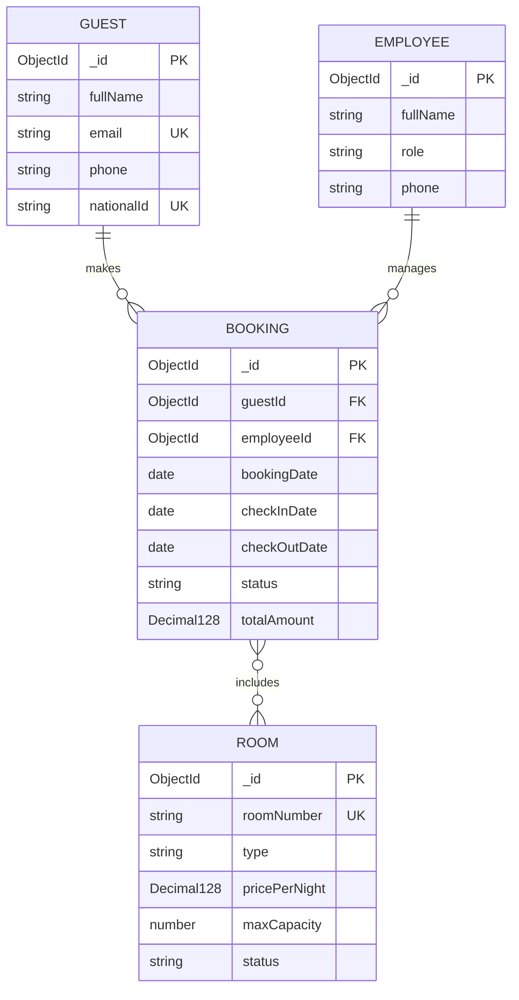

# Task8 -  Ahmad Alabdi

## 1. نظرة عامة

هذا التطبيق هو نظام لإدارة الفنادق يتكون من أربع كيانات رئيسية وهي :الضيوف والغرف والموظفين والحجوزات .

قد يقوم ضيف بإنشاء عدة حجوزات وكل حجز قد يتضمن عدة غرف .تتبع كل حجز لضيف ولموظف واحد فقط .قد يتم استخدام الغرفة في عدة حجوزات طالما أن تواريخ تسجيل الوصول وتسجيل الخروج لا تتطابق .
## 2. المجموعات والحقول

### 2.1 الضيوف

|المجال|النوع|القيود| التصنيف|
|---|---|---|---|
|_id|ObjectId| مفتاح رئيسي يتم توليده تلقائياً|التحقق والمعالجة|
|الاسم الكامل|String|إلزامي|بيانات|
|البريد الألكتروني|String|إلزامي وفريد|بيانات/التحقق|
|الهاتف|String|إلزامي|بيانات|
|الرقم القومي|String|إلزامي وفريد|بيانات/التحقق|

### 2.2 الغرف

| الحقل | النوع | القيود | التصنيف |
| --- | --- | --- | --- |
| _id | ObjectId | مفتاح أساسي يتم توليده تلقائيا |التحقق والمعالجة |
| رقم الغرفة | String | مطلوب وفريد | البيانات |
| النوع | String | فردي، مزدوج، جناح، فاخر | البيانات |
| السعر لليلة | Decimal128 | مطلوب ولا يمكن أن يكون أقل من الصفر | البيانات |
| السعة القصوى | عدد | عدد صحيح أكبر من الصفر | البيانات |
| الحالة | String | متاحة،صيانة، خارج الخدمة | التحقق والمعالجة |

ملاحظة: خاصية الحالة تظهر فقط الحالة التشغيلية للغرفة.لمعرفة توافر الغرف في تاريخ معين يجب أن نمر على الحجوزات.

### 2.3 الموظفين

|المجال| النوع | القيود | التصنيف|
| ----------- | --------- | ------------------------------- | ------------------------- |
| _id | ObjectId | مفتاح أساسي يتم توليده تلقائيا |التحقق والمعالجة |
| الاسم الكامل | String | مطلوب | البيانات |
| الدور | String | المستقبل، المدير، المشرف | البيانات |
| الهاتف | String | مطلوب | البيانات |

### 2.4 الحجوزات

|المجال| النوع | القيود | التصنيف|
| ---------------------- | ------------- | ------------------------------------------------------- | --------------------------- |
| _id | ObjectId | مفتاح أساسي يتم توليده تلقائيا |التحقق والمعالجة |
| رقم الضيف | ObjectId | إشارة إلى الضيوف | العلاقة |
| رقم الموظف | ObjectId | إشارة إلى الموظفين | العلاقة |
| الغرف | Array | يجب أن تكون هناك غرفة واحدة على الأقل | العلاقة |
| الغرف[i].الغرفة | ObjectId | إشارة إلى الغرف | العلاقة |
| الغرف[i].السعر لليلة | Decimal128 | سعر الغرفة في وقت الحجز | البيانات |
| تاريخ الحجز | Date | التاريخ الذي تم فيه إنشاء الحجز | البيانات |
| تاريخ الدخول | Date | مطلوب | البيانات |
| تاريخ الخروج | Date | يجب أن يكون لاحقا لتاريخ الدخول | التحقق والمعالجة |
| الحالة | String | معلق، مؤكد، تم الدخول، تم الخروج، ملغى | البيانات |
| المبلغ الإجمالي | Decimal128 | يتم حسابه تلقائيا | التحقق والمعالجة |

يتم تخزين السعر لليلة داخل الحجز حتى لا يتم تغيير أسعار الحجوزات القديمة عندما يتغير السعر.
## 3. Schema Diagrams of Mongoose

Code snippets for some schema diagrams:

### Guest.js

```js
const mongoose = require('mongoose');

const guestSchema = new mongoose.Schema({
  fullName: { type: String, required: true, trim: true },
  email: {
    type: String, required: true, unique: true,
    lowercase: true, trim: true
  },
  phone: { type: String, required: true, trim: true },
  nationalId: { type: String, required: true, unique: true, trim: true }
}, { timestamps: true });

module.exports = mongoose.model('Guest', guestSchema);
```

##4. العلاقات

| العلاقة | نوع العلاقة | الوصف |
|---|---|---|
| ضيف->حجز | M:1 | يمكن أن يكون هناك العديد من الحجوزات لضيف واحد |
| موظف->حجز | M:1 | يمكن أن يكون هناك العديد من الحجوزات التي يتحكم فيها موظف واحد |
| حجز<->غرفة | M:M | يمكن لحجز واحد أن يشمل العديد من الغرف ويمكن أن تظهر غرفة في حجوزات مختلفة |
| فندق->غرفة | M:1 | يوجد العديد من الغرف في فندق واحد |

في MongoDB لن يكون هناك مجموعة منفصلة للعلاقة بين حجز وغرفة سنضع الغرف في حقل Bookings.rooms .

مخطط ERD:




## 5. Predicted REST APIs

| طريقة HTTP | العنوان | الوصف |
|---|---|---|
| POST | /api/guests | إنشاء ضيف |
| GET | /api/guests | قائمة بجميع الضيوف |
| GET | /api/guests/:id | عرض ضيف معين |
| PATCH | /api/guests/:id | تحديث بيانات الضيف |
| DELETE | /api/guests/:id | إزالة ضيف بدون أي حجوزات |
| POST | /api/rooms | إنشاء غرفة |
| GET | /api/rooms | قائمة بجميع الغرف |
| GET | /api/rooms/:id | عرض غرفة معينة |
| PATCH | /api/rooms/:id | تحديث غرفة |
| DELETE | /api/rooms/:id | إزالة غرفة بدون أي حجوزات |
| GET | /api/rooms/availability | البحث عن توافر الغرف حسب التاريخ |
| POST | /api/employees | إنشاء موظف |
| GET | /api/employees | قائمة بجميع الموظفين |
| GET | /api/employees/:id | عرض موظف معين |
| PATCH | /api/employees/:id | تحديث بيانات الموظف |
| DELETE | /api/employees/:id | إزالة موظف بدون أي حجوزات |
| POST | /api/bookings | إنشاء حجز |
| GET | /api/bookings | قائمة بجميع الحجوزات |
| GET | /api/bookings/:id | تفاصيل الحجز |
| PATCH | /api/bookings/:id | تحديث حجز وإعادة التحقق من التوافر |
| POST | /api/bookings/:id/confirm | تأكيد حجز |
| POST | /api/bookings/:id/check-in | تسجيل دخول ضيف |
| POST | /api/bookings/:id/check-out | تسجيل خروج ضيف |
| POST | /api/bookings/:id/cancel | إلغاء حجز |

## 6. تقنيات ومكتبات

| التقنية | الاستخدام |
|---|---|
| Node.js | تنفيذ جافا سكريبت في بيئة الخادم |
| Express | تطوير واجهات برمجة التطبيقات (APIs) بنظام REST وتنظيم المسارات |
| MongoDB | تخزين معلومات النظام |
| Mongoose | تطوير مخططات التفاعل مع MongoDB |
| dotenv | تخزين إعدادات المشروع باستخدام المتغيرات البيئية |
| morgan | تسجيل طلبات HTTP |
| nodemon | إعادة تشغيل التطبيق تلقائياً في حالة التطوير |
| decimal.js | حساب المبالغ المالية (مكتبة اختيارية) |

## 7. هيكلية المشروع (MVC)


```text
src/
├── controllers/
│   ├── guests.controller.js
│   ├── rooms.controller.js
│   ├── employees.controller.js
│   └── bookings.controller.js
├── middlewares/
│   ├── notFound.js
│   └── errorHandler.js
├── models/
│   ├── Guest.js
│   ├── Room.js
│   ├── Employee.js
│   └── Booking.js
├── routes/
│   ├── guests.routes.js
│   ├── rooms.routes.js
│   ├── employees.routes.js
│   └── bookings.routes.js
├── services/
│   └── booking.service.js
├── utils/
│   └── connect.js
└── app.js
```